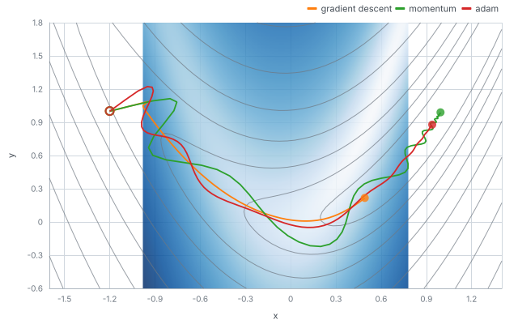
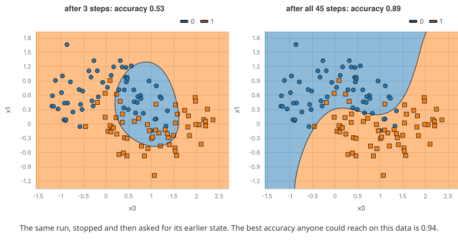
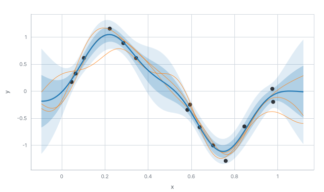
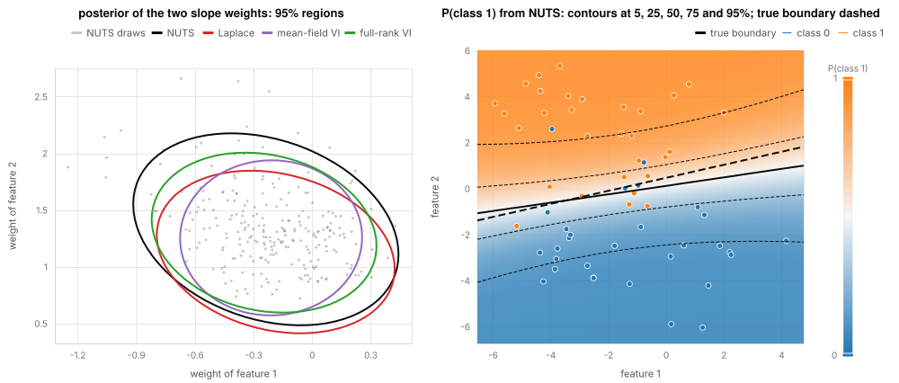
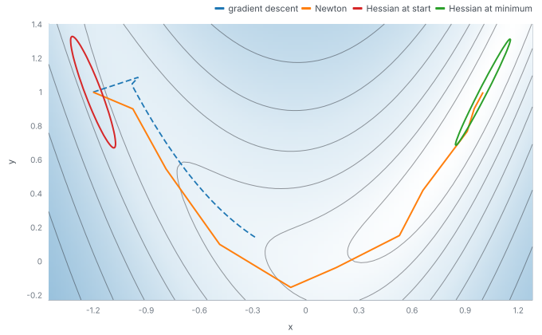
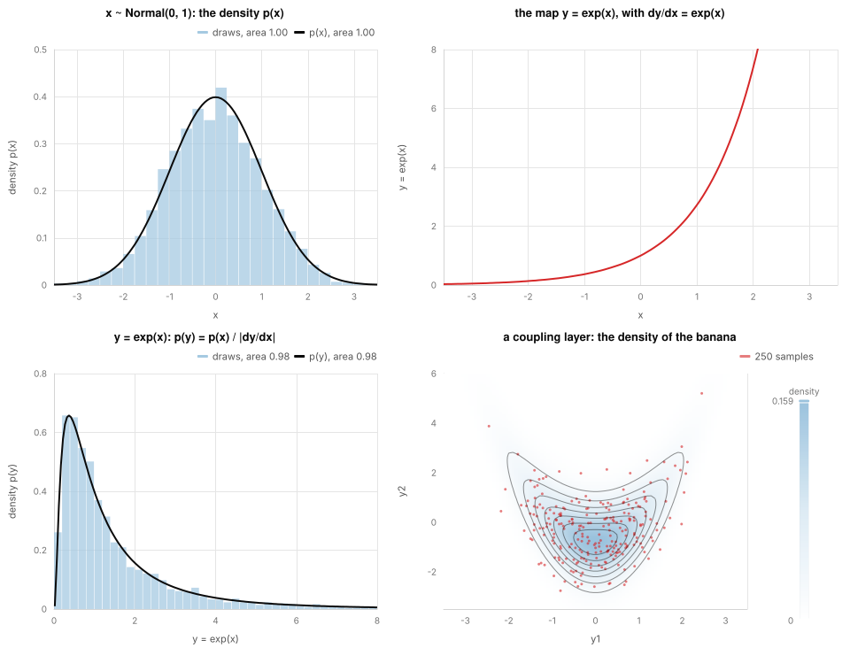
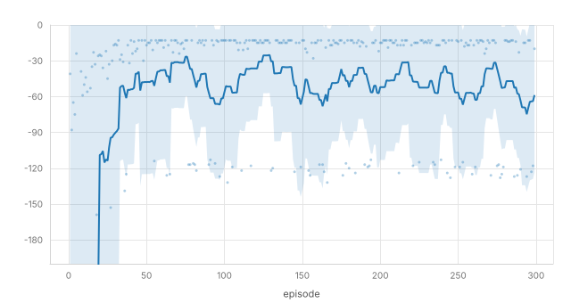

# mdml-js

All of machine learning in one TypeScript library.

Numerics, probability, classical learning, neural networks, reinforcement learning and datasets live together and work
the same way, so you can try an idea without gluing six libraries together. It is built for prototyping and for
understanding, not for being the fastest.

## The ideas

They build on each other, and there are more than these. `docs/structure.md` has the full set.

**1. One library for all of ML.** This is the goal. Things that are usually separate packages share one set of tools:
tensors, random numbers, datasets, optimisers and metrics. There is no separate layer of methods on top: a demonstration
of a method is a short page that combines an estimator with a dataset.

**2. Everything leaves a trace.** This is the key idea. Every routine that runs in steps (an optimiser, a sampler, a
trainer, an agent) records what it did as it went: the state, the metrics and how it ended. You can pause a run, replay it,
jump to any step, save it, and draw it. The figures, the players and the documentation all read the same record.

```ts
import { grad } from 'mdml-engine/autodiff'
import { mul, tensor, toArray, type Value } from 'mdml-engine/tensor'

toArray(grad((x: Value) => mul(x, x))(tensor(3))) // => 6
```

**3. Models are configurations.** A model is a small setting you can read, not a class to subclass. Logistic, ridge and
lasso regression are settings of one linear model. A choice like the solver is a slot you fill from a list of options, so
a model is never tied to one solver.

**4. Data knows the truth.** Every dataset generator carries the ground truth it was made from (the true parameters, the
true labels, the true shift), so you can check what a method found against what was really there.

**5. Results explain themselves.** What a method found comes back with plain, typed records of what is worth showing. The
render package turns those records into figures, and nothing in the library has to know about drawing.

**6. Tensors, with gradients when you ask.** Tensors are plain arrays until you want a gradient. Then `grad`, `vmap`,
`jvp` and `hessian` work on that call, as in JAX.

**7. Randomness is explicit.** You pass in a key, and the same key gives the same numbers. The library never uses a clock
or hidden state, so any run can be repeated exactly.

**8. Checked against the standard libraries.** The numerical code is tested against results from numpy, scipy, torch and
others, so you can trust that it agrees with what you already know.

**9. The code documents itself.** Every folder, file and export is described, and every example in the docs is run by the
build. A generated index of the main things (`llms.txt`) helps people and tools find their way.

## Examples

Each example below is part of a program in `examples/<name>/main.tsx`. The program computes with the library, draws the
figure with the render package and keeps the tape of its run. The values in the comments are what the programs printed.
`examples/README.md` lists more examples. `make readme-examples` runs them all again, and `make readme-examples-check`
fails if a figure is out of date.

### An optimiser's trace

Three optimisers run on the Rosenbrock function. Each run records its parameters at every step, and the figure is drawn
from those records.

```ts
import { adam, minimizer, sgd } from 'mdml-engine/optim'
import { add, mul, square, sub, take, tensor, type Value } from 'mdml-engine/tensor'
import { policies, recorder, runAlgorithm } from 'mdml-engine/trace'

const rosenbrock = (p: Value) => add(square(sub(1, take(p, 0))), mul(10, square(sub(take(p, 1), square(take(p, 0))))))
const tape = recorder()
const run = runAlgorithm(
  minimizer((p) => rosenbrock(p as Value), tensor([-1.2, 1]), adam({ learningRate: 0.1 })),
  {
    seed: 0,
    maxSteps: 120,
    tracer: tape,
    policy: policies.teaching,
  },
)
run.state.value // => 0.0039 (gradient descent: 0.2657, with momentum: 0.0001); tape.run() holds every step
```



### Pausing and going back

A session runs a method one step at a time. It can be stopped, run on, and asked for the model as it was at an earlier
step. The dataset records the best possible accuracy.

```ts
import { generate } from 'mdml-engine/data'
import { moons } from 'mdml-engine/datasets'
import { key } from 'mdml-engine/random'
import { svc } from 'mdml-engine/svm'

const { data, truth } = generate(moons, { knobs: { n: 120, noise: 0.25 }, key: key(0) })
const run = svc.with({ kernel: 'rbf', C: 1 }).session(data, { key: key(1) })
run.advance({ steps: 3 }) // pause after three steps of the solver
run.advance() // run on to the end: 45 steps
run.probe(3, 'model/decision-surface') // jump back to step 3 and ask for its decision surface
run.fittedAt(3).score(data) // => 0.533
run.fittedAt(run.t).score(data) // => 0.892, where 1 - truth.bayesError = 0.941 is the best anyone could do
```



### A Gaussian process and the gradient of its likelihood

The likelihood is written as an ordinary function of the kernel's hyperparameter, and `grad` differentiates it.

```ts
import { grad } from 'mdml-engine/autodiff'
import { gram, rbfKernel, withTheta } from 'mdml-engine/kernels'
import { choSolve, cholesky } from 'mdml-engine/numerics/linalg'
import { add, diagonal, eye, log, mul, sum, tensor, type Value } from 'mdml-engine/tensor'

const x = tensor([[0], [0.7], [1.5], [2.2]])
const y = tensor([0.1, 0.9, 0.8, -0.2])
const kernel = rbfKernel({ lengthScale: 1 })

const nll = (theta: Value) => {
  // negative log marginal likelihood, up to a constant
  const L = cholesky(add(gram(withTheta(kernel, theta), x), mul(eye(4), 0.1)))
  const a = choSolve(L, y)
  return add(mul(sum(mul(y, a)), 0.5), sum(log(diagonal(L))))
}
grad(nll)(tensor([0])) // => [0.1209288], d nll / d log(lengthScale)
```

The library has its own version, `negativeLogMarginalLikelihood` in `mdml-engine/gp`, with a hand-derived gradient. It
gives the same number to ten digits and is faster inside an optimiser. A test checks both against a finite difference.
`gpRegression` fits the kernel with it, one optimiser step at a time:

```ts
import { generate } from 'mdml-engine/data'
import { sineCurve } from 'mdml-engine/datasets'
import { gpRegression } from 'mdml-engine/gp'
import { constantKernel, productKernel, rbfKernel } from 'mdml-engine/kernels'
import { key } from 'mdml-engine/random'

const { data } = generate(sineCurve, { knobs: { n: 14, noise: 0.15, design: 'sorted' }, key: key(0) })
const kernel = productKernel(constantKernel({ value: 1 }), rbfKernel({ lengthScale: 0.5 }))
const fit = gpRegression.with({ kernel, alpha: 0.03 }).session(data, { key: key(1) })
fit.advance() // L-BFGS-B on the gradient above: 11 steps
fit.fittedAt(fit.t).params.logMarginalLikelihood // => -3.572, with amplitude 0.417 and length scale 0.14
fit.probe(fit.t, 'model/posterior', { resolution: 120, samples: 3, seed: 3 }) // the mean, the band and three draws
```



### Bayesian logistic regression

The posterior of a logistic regression has no closed form. The model is written once as a probabilistic program, and
the inference is chosen separately. NUTS is the reference here, and the dataset knows the true class boundary.

```ts
import { bernoulli, multivariateNormal } from 'mdml-engine/dists'
import { autoMultivariateNormal, laplaceApproximation, mcmc, observe, plate, sample, svi } from 'mdml-engine/probprog'
import { eye, matmul, mul } from 'mdml-engine/tensor'

// X is a column of ones and the two features of 60 points of two blobs; y holds their 0/1 labels
const prior = multivariateNormal([0, 0, 0], { covariance: mul(eye(3), 25) })
const model = (y: number[]) => {
  const w = sample('w', prior)
  plate('n', y.length, () => observe('y', bernoulli({ logits: matmul(X, w) }), y))
}
mcmc(model, y, { key: key(3), numChains: 4, numWarmup: 500, numDraws: 1000 }) // NUTS: 4000 draws, R-hat at most 1.002
laplaceApproximation(model, y, { key: key(1) }) // a Gaussian at the MAP, with the inverse Hessian as covariance
svi(model, y, { key: key(2), numSteps: 2000 }).posterior // mean-field variational inference
svi(model, y, { key: key(2), numSteps: 2000, guide: autoMultivariateNormal(model) }).posterior // full-rank
```

The Laplace approximation is a Gaussian at the MAP whose covariance is the inverse of the Hessian there. The MAP comes
from handing the model to a solver as an objective:

```ts
import { hessian } from 'mdml-engine/autodiff'
import { inv } from 'mdml-engine/numerics/linalg'
import { lbfgs } from 'mdml-engine/optim'
import { potentialEnergy } from 'mdml-engine/probprog'
import { neg, tensor, type Value } from 'mdml-engine/tensor'

const um = potentialEnergy(model, y) // the log joint on the unconstrained reals
const map = lbfgs((u) => neg(um.fn(u as Value)), tensor([0, 0, 0]), {}) // => [-0.088, -0.186, 1.123]
inv(hessian((u) => neg(um.fn(u)))(map.x)) // its diagonal gives the Laplace standard deviations 0.61, 0.25, 0.29
```

Posterior mean ± standard deviation of the intercept and the two weights:

|                  | intercept    | feature 1    | feature 2   |
| ---------------- | ------------ | ------------ | ----------- |
| NUTS (reference) | -0.13 ± 0.66 | -0.24 ± 0.28 | 1.32 ± 0.35 |
| Laplace          | -0.09 ± 0.61 | -0.19 ± 0.25 | 1.12 ± 0.29 |
| mean-field VI    | -0.07 ± 0.46 | -0.21 ± 0.19 | 1.26 ± 0.28 |
| full-rank VI     | -0.09 ± 0.60 | -0.25 ± 0.23 | 1.31 ± 0.30 |

Mean-field VI treats the weights as independent, so its spread is smaller than NUTS. Full-rank VI is close to NUTS.
Laplace sits on the mode, and the posterior is skewed (the mode of feature 2 is 1.12 and the mean is 1.32), so it is
narrower than NUTS and off to one side. A probit model changes one line, `bernoulli({ probs: ndtr(matmul(X, w)) })`. NUTS
gives -0.09 ± 0.35, -0.09 ± 0.13 and 0.68 ± 0.15 for it, and Laplace gives -0.06 ± 0.34, -0.07 ± 0.13 and 0.62 ± 0.14.



### Second derivatives

`grad` can be applied to its own result, and `hessian` and `hvp` are built from it. Newton's method uses the Hessian. On
the Rosenbrock function it takes 12 steps where gradient descent takes 2662.

```ts
import { grad, hessian, hvp } from 'mdml-engine/autodiff'
import { minimize, newton, sgd } from 'mdml-engine/optim'
import { mul, tensor, type Value } from 'mdml-engine/tensor'

const cube = (x: Value) => mul(mul(x, x), x)
grad(grad(cube))(tensor(2)) // => 12
hessian(rosenbrock)(tensor([1, 1])) // => [[82, -40], [-40, 20]]
hvp(rosenbrock, tensor([1, 1]), tensor([1, 0])) // => [82, -40]
newton(rosenbrock, [-1.2, 1]).steps // => 12
minimize(rosenbrock, tensor([-1.2, 1]), { method: sgd({ learningRate: 0.01 }), maxSteps: 5000, gradTol: 1e-5 }).steps // => 2662
```

`hvp` gives the Hessian times a vector without forming the Hessian. It costs about two gradients however many
parameters there are, so it still works for large models. The ellipses in the figure come from the Hessian at the start
and at the minimum.



### Bijections between distributions

A bijector is an invertible map with its log-Jacobian. `transformed` pushes a distribution through one and applies the
change of variables, so `logProb` stays exact.

```ts
import { bijectors, normal } from 'mdml-engine/dists'
import { transformed } from 'mdml-engine/dists/compose'
import { key } from 'mdml-engine/random'
import { mul, square, sub, tensor } from 'mdml-engine/tensor'

const lognormal = transformed(normal(0, 1), bijectors.exp())
lognormal.logProb(2) // => -1.852312, the closed form of the log-normal density at 2
lognormal.sample(key(0), [4000]) // 4000 draws, mean 1.631 (exp(1/2) = 1.649)

// a coupling layer bends a 2-D Gaussian into a banana
const bend = bijectors.affineCoupling(1, (xa) => ({ shift: sub(mul(0.8, square(xa)), 0.8), logScale: mul(xa, 0) }))
transformed(normal([0, 0], [1, 1]), bend).logProb(tensor([0, -0.8])) // => -1.8379
```

The maps from the real line onto each support (`bijectors.unconstrained`) are how NUTS, Laplace and variational
inference run on constrained parameters: they work on the reals, and the Jacobian keeps the density correct.



### An agent learning

Q-learning on the cliff-walking gridworld. The learning curve is drawn from the recorded run.

```ts
import { qLearning } from 'mdml-engine/agents'
import { cliffWalking } from 'mdml-engine/environments'
import { make, trainAgent } from 'mdml-engine/rl'
import { recorder, tracePolicy } from 'mdml-engine/trace'

const tape = recorder()
const agent = qLearning(cliffWalking.create(), { alpha: 0.5, gamma: 1, epsilon: 0.1 })
const trained = trainAgent(make(cliffWalking), agent, {
  episodes: 300,
  seed: 0,
  tracer: tape,
  policy: tracePolicy({ metrics: false }),
})
trained.returns.slice(0, 3) // => [-2216, -41, -88]; the mean of the last 50 episodes is -53.8
```



## Packages

| package | what it is |
| --- | --- |
| `mdml-engine` | the library: tensors, autodiff, numerics, distributions, optimisation, kernels, learning, neural networks, RL, graphs, datasets and the trace. Imports as `mdml-engine/<domain>`. |
| `mdml-render` | figures from results and traces: charts, layouts, drawings, SVG and animation export, and React components (hooks, players, panels). |
| `mdml-meta` | the documentation tooling: it reads the code's descriptions, runs the examples and keeps the concept list. |

The packages share a version number (see `CHANGELOG.md`).

## Where to start

- `llms.txt` is the map of the packages. It leads to `packages/engine/llms.txt` and `packages/render/llms.txt`, which list
  the main things in each area with their file and import path.
- `docs/structure.md` is the plan: what is in the library, the shared rules, and the order it is built in.
- `docs/methods-catalog/` lists the methods the library is meant to cover, area by area.
- `docs/code-review/` is the record of a structural review of the core. Start at `docs/code-review/summary.md`.

## Working on it

Node, pnpm, Python and uv are pinned in `mise.toml`. Everything goes through `make`:

```sh
make setup            # install the tools and dependencies
make verify           # check a change: quick whole-repo checks, then only the tests it touches
make check            # everything, every test and example (a periodic full run)
make fixtures-check   # rebuild the reference results from the Python oracle and compare
make help             # list every target
```

The reference results for the numerical code come from standard Python libraries (numpy, scipy, torch and others) in
`oracle/`. The tests themselves never run Python. The public surface is guarded by a digest (`make api-surface-check`),
the layering by `make layers`, and the agent index by `make agent-index-check`.

## Licence

MIT.
