# Examples

Each folder is a program. `main.tsx` computes with `mdml-engine` (a traced run, an estimator session) and draws the
result with `mdml-render`; `figure.svg` is its figure and `tape.json` the tape of the run behind it, which the
site's player can replay. `make readme-examples` runs them all and writes these files (`make readme-examples-check`
fails when they are stale). To add an example, add a folder with a `main.tsx` that follows
`_shared/contract.ts`; nothing else lists it. This file is generated.

# In the README

## Bijections between distributions

A Normal through exp is a log-normal; a coupling layer turns a Gaussian into a banana. The density stays exact.

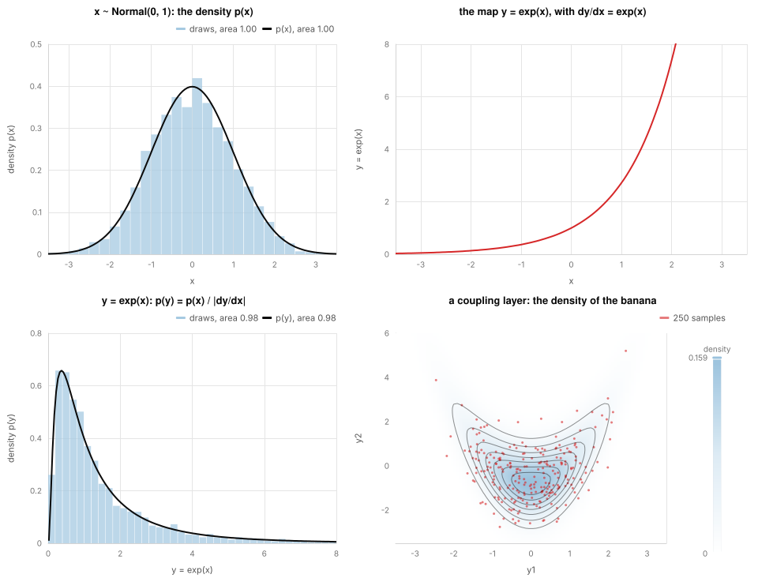

[bijectors/main.tsx](bijectors/main.tsx)

## A Gaussian process, tuned by a gradient

grad of the marginal likelihood written as a plain function, and a Gaussian process fitted on that gradient.

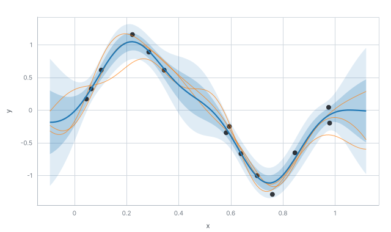

[gp/main.tsx](gp/main.tsx), tape: [tape.json](gp/tape.json)

## Bayesian logistic regression, approximated four ways

The weight posterior by NUTS, Laplace and two variational fits, and the predicted probability beside the true boundary.

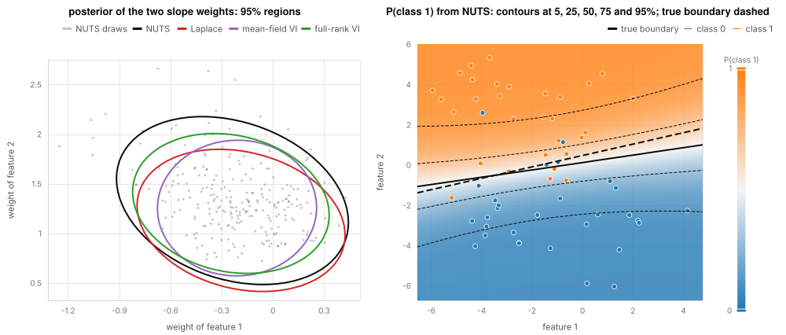

[logistic/main.tsx](logistic/main.tsx), tape: [tape.json](logistic/tape.json)

## Second order: grad of grad, Hessians and Newton

grad(grad(f)), hessian and hvp; Newton reaches the minimum in 12 steps where gradient descent needs 2662.

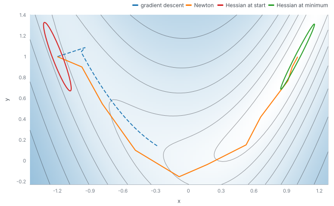

[newton/main.tsx](newton/main.tsx), [newton/README.md](newton/README.md), tape: [tape-gradient-descent.json](newton/tape-gradient-descent.json), tape: [tape-newton.json](newton/tape-newton.json)

## Optimisers, first and second order

Gradient descent, momentum and Adam against BFGS, L-BFGS and Newton on the Rosenbrock function: the paths and the loss from the recorded runs.

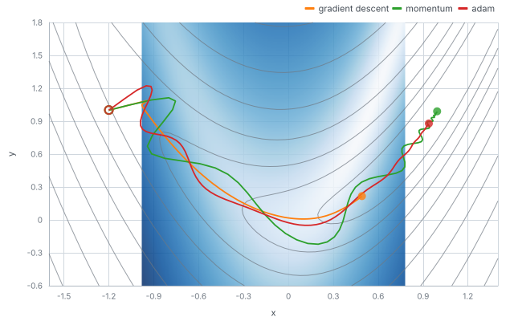

[optimisers/main.tsx](optimisers/main.tsx), [optimisers/README.md](optimisers/README.md), tape: [tape-adam.json](optimisers/tape-adam.json), tape: [tape-bfgs.json](optimisers/tape-bfgs.json), tape: [tape-gradient-descent.json](optimisers/tape-gradient-descent.json), tape: [tape-lbfgs.json](optimisers/tape-lbfgs.json), tape: [tape-momentum.json](optimisers/tape-momentum.json), tape: [tape-newton.json](optimisers/tape-newton.json)

## An agent learning

Q-learning on the cliff-walking gridworld: the return of each episode, drawn from the recorded run.

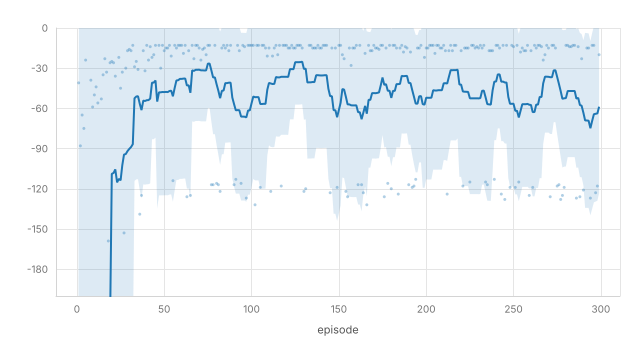

[qlearning/main.tsx](qlearning/main.tsx), tape: [tape.json](qlearning/tape.json)

## The metrics of a classifier

The ROC curve, the precision-recall curve, the precision-recall gain curve and the contingency table of a support vector classifier on held-out data.


[roc/main.tsx](roc/main.tsx), [roc/README.md](roc/README.md), tape: [tape.json](roc/tape.json)

## Pause, jump back, compare with the truth

A support vector classifier as a session: its decision surface at step 3 and at the end, and the best possible accuracy.

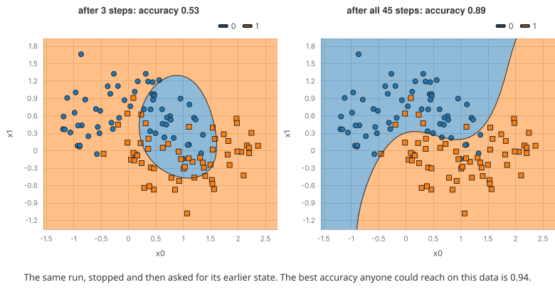

[session/main.tsx](session/main.tsx), tape: [tape.json](session/tape.json)

# More

## Which arm to pull

Epsilon-greedy, UCB1 and Thompson sampling on a five-armed bandit: the regret curves and how often each arm was pulled.

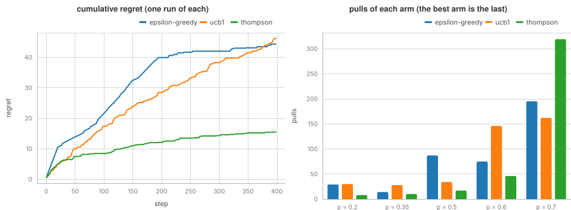

[bandit/main.tsx](bandit/main.tsx), [bandit/README.md](bandit/README.md), tape: [tape-epsilon-greedy.json](bandit/tape-epsilon-greedy.json), tape: [tape-thompson.json](bandit/tape-thompson.json), tape: [tape-ucb1.json](bandit/tape-ucb1.json)

## A Gaussian mixture, step by step

Expectation-maximisation for three overlapping Gaussians: the density, the log likelihood and the soft assignments.

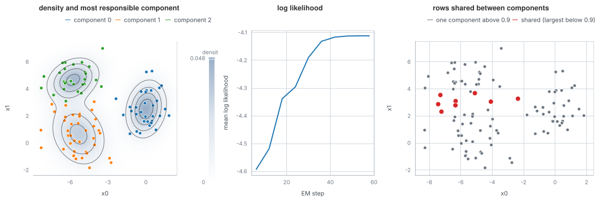

[clustering/main.tsx](clustering/main.tsx), [clustering/README.md](clustering/README.md), tape: [tape.json](clustering/tape.json)

## A decision tree and the regions it cuts

A classification tree on two iris measurements, drawn by the library as its splits and as the regions of the plane.

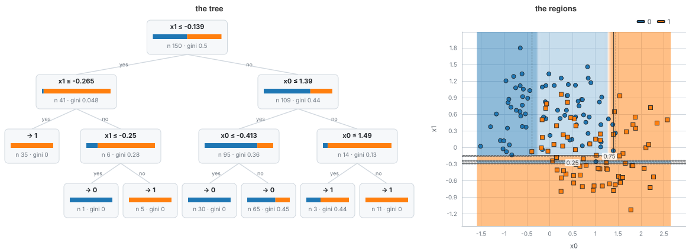

[decision-tree/main.tsx](decision-tree/main.tsx), [decision-tree/README.md](decision-tree/README.md), tape: [tape.json](decision-tree/tape.json)

## A rolled-up sheet, flattened

A Swiss roll as it is, by PCA and by t-SNE, each point coloured by its true position along the sheet.

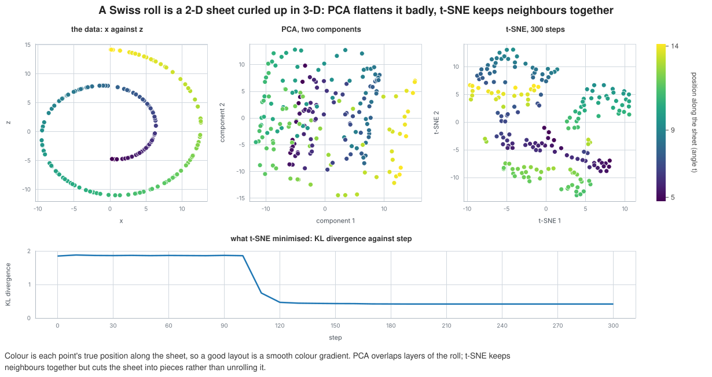

[embedding/main.tsx](embedding/main.tsx), [embedding/README.md](embedding/README.md), tape: [tape.json](embedding/tape.json)

## A neural additive model, from its spline bases

A learnable spline with no smoothness penalty: the weighted basis functions and their sum come up to the points as it trains (learning.gif).

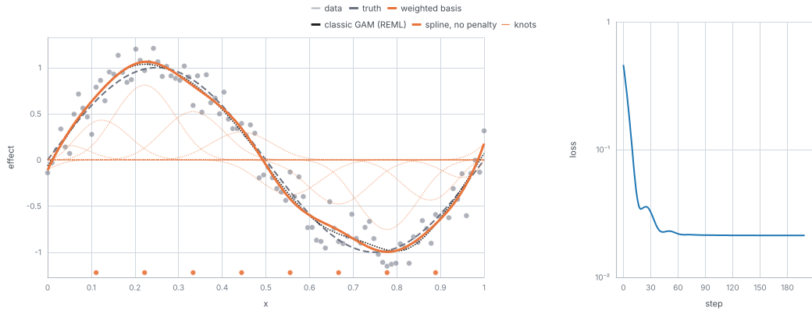

[gam-neural/main.tsx](gam-neural/main.tsx), [gam-neural/README.md](gam-neural/README.md), animation: [learning.gif](gam-neural/learning.gif), tape: [tape.json](gam-neural/tape.json)

## A small neural network, trained and watched

A multilayer perceptron on the two moons: the loss at every step, and the decision surface at the start, the middle and the end.

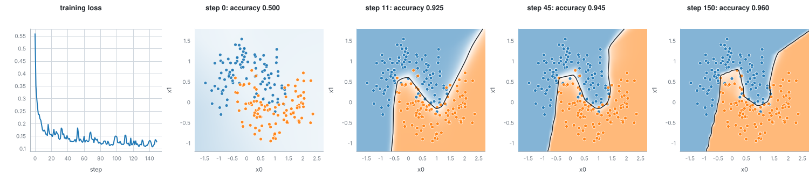

[neural-network/main.tsx](neural-network/main.tsx), [neural-network/README.md](neural-network/README.md), tape: [tape.json](neural-network/tape.json)

## Principal components of the iris data

PCA found one component per step: the flowers in the first two components, the variance each explains, the loadings.

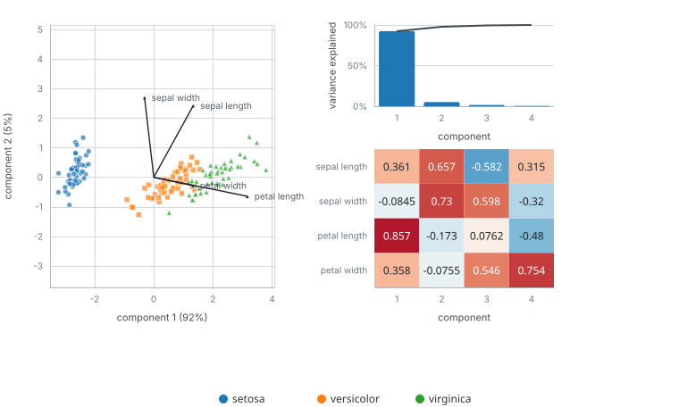

[pca/main.tsx](pca/main.tsx), [pca/README.md](pca/README.md), tape: [tape.json](pca/tape.json)

## A logic program and its proof search

A small Prolog family database; the query is answered by SLD resolution and the search tree is drawn from the run.

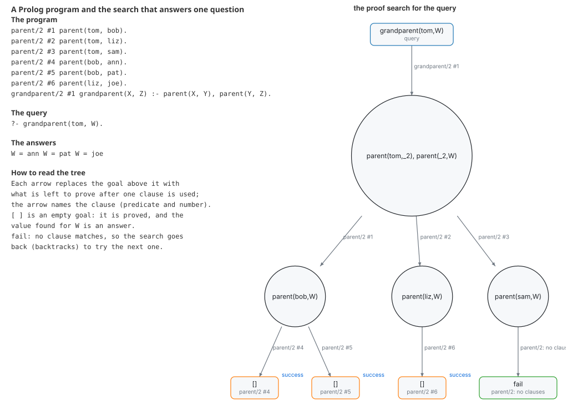

[prolog/main.tsx](prolog/main.tsx), [prolog/README.md](prolog/README.md), tape: [tape.json](prolog/tape.json)

## A sampler on a banana

NUTS on a twisted Gaussian: the draws over the true density, the trace of one coordinate, R-hat and effective sample size.

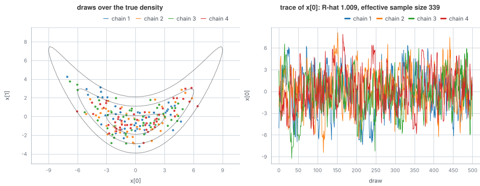

[sampler/main.tsx](sampler/main.tsx), [sampler/README.md](sampler/README.md), tape: [tape.json](sampler/tape.json)

## A SAT solver at work

Six pigeons in five holes as a Boolean formula: DPLL and CDCL both prove it unsatisfiable, and their traces differ.

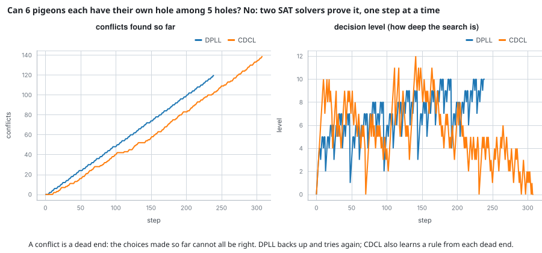

[sat/main.tsx](sat/main.tsx), [sat/README.md](sat/README.md), tape: [tape-cdcl.json](sat/tape-cdcl.json), tape: [tape-dpll.json](sat/tape-dpll.json)

## Support vectors and the margin

A kernel support vector classifier with a small and a large C: the score, the boundary, the margins and the support vectors.

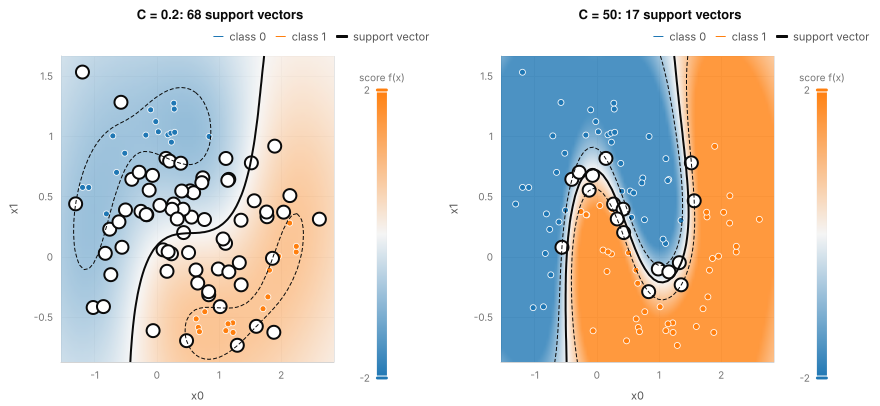

[svm/main.tsx](svm/main.tsx), [svm/README.md](svm/README.md), tape: [tape-large-c.json](svm/tape-large-c.json), tape: [tape-small-c.json](svm/tape-small-c.json)

