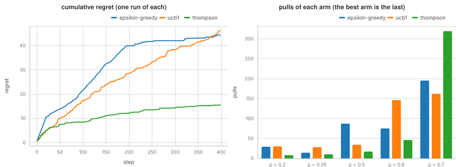

# Which arm to pull

A five-armed bandit: each arm pays 1 with a probability the player does not know (0.2, 0.35, 0.5, 0.6 and 0.7). Each
pull is both a chance to earn and a chance to learn, so the player has to balance trying new arms with pulling the best
one found so far. Three strategies from `omai-engine/agents` play 400 pulls each.

## The program

`banditAlgorithm` runs an agent on the environment as a traced algorithm. After every pull it logs the arm chosen and the
regret so far: the reward the best arm would have earned in expectation, minus what the arm pulled would. The
environment's oracle supplies those expectations. The strategies are epsilon-greedy (a random arm one time in ten),
UCB1 (the arm with the highest optimistic estimate) and Thompson sampling (the arm whose sampled success probability is
highest).

## What to look for

- Left: regret against pulls. A good strategy's curve flattens as it settles on the best arm.
- Right: the count of pulls per arm, taken from the recorded arms. Thompson sampling pulled the best arm 319 times of
  400, UCB1 162 and epsilon-greedy 195.
- This figure is one run (seed 2), so it is only one draw. Averaged over seeds 0 to 9, the final regrets are
  epsilon-greedy 37.1, UCB1 45.2 and Thompson sampling 20.2. UCB1 with its default exploration constant explores a
  lot on a short run, so here it does no better than epsilon-greedy.

## Run it

`make readme-examples ARGS="bandit"` writes `figure.svg` and one tape per strategy. The program is [main.tsx](main.tsx).
