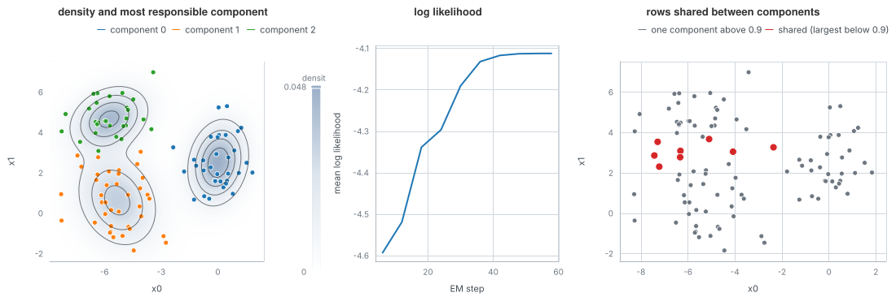

# A Gaussian mixture, step by step

A Gaussian mixture explains the data as a few overlapping bell-shaped clouds. Expectation-maximisation (EM) fits it by
repeating two steps: give every row a share in each cloud (its responsibilities), then move each cloud to match its
rows. This example records the run and draws the result from the recording.

## The data and the method

The data is 100 points from the blobs generator: three Gaussian clusters that overlap (standard deviation 1.3 in a box of
half-width 6). The generator keeps the label of each point. The algorithm is `gaussianEmAlgorithm` from
`mdml-engine/mixture`, started from random responsibilities and run until the log likelihood changes by less than 1e-5.

## What the program does

1. Generate the data and a starting mixture, and run EM with a recorder attached. Every sixth step is kept, which keeps the
   tape small (about 80 KB).
2. Read the tape: the mean log likelihood at each kept step, and the weights, means, covariances and responsibilities of
   the last kept step.
3. Evaluate the mixture's density on a grid that covers exactly the data's extent, and draw it as a heat map with contours.
   Each row is coloured by its most responsible component.
4. Draw the log likelihood against the step, and pick out the rows whose largest responsibility is below 0.9.

## What to look for

The run converges in 58 steps; the mean log likelihood climbs from -4.594 at the first kept step to -4.112 and never goes
down, as EM guarantees. The contours follow the clouds, and are not circles because each component has its own covariance.
Only 8 of the 100 rows have no component above 0.9: they lie between two clouds. Compared with the true blobs, the
adjusted Rand index is 0.808.

## Run it

`make readme-examples ARGS="clustering"` rewrites `figure.svg` and `tape.json`.
The program is [main.tsx](main.tsx); the density helper is in [../_shared/maps.ts](../_shared/maps.ts).
