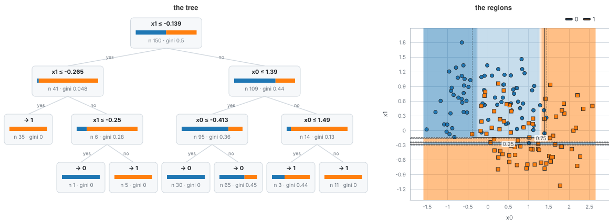

# A decision tree and the regions it cuts

A decision tree asks a series of yes/no questions about one feature at a time. This example grows one on two-moons data
and draws it twice: as the tree of questions, and as what those questions do to the plane.

## The data and the method

The data is 150 points from the two-moons generator (noise 0.3), which carries its truth: the best possible accuracy is
0.911. The model is `decisionTreeClassifier` from `mdml-engine/trees` (gini criterion, depth at most 3), run as a
session that decides one node per step. Five candidate splits per feature and node are kept on the tape.

## What the program does

1. Generate the data (and 400 fresh points to test on) with fixed keys.
2. Run the session to the end: 13 steps, one per node. Ask it for its `model/structure` record.
3. Ask the fitted tree for the probability of class 1 at every point of a grid that covers exactly the data's extent.
4. Draw the record with the render package's tree view, and the probabilities as a heat map (orange towards class 1, blue
   towards class 0) with the contour at probability 0.5 as the decision boundary.

## What to look for

Each card in the tree is a split (for example `x1 <= -0.139`), the number of rows that reach it and their gini impurity.
Each leaf of the tree is one rectangle in the map: inside it the probability is constant, so the colours are blocks and
the boundary is a staircase, because every split is parallel to an axis. Accuracy is 0.847 on the training rows and 0.843
on the 400 new points, below the best possible 0.911: a depth-3 tree cannot follow a curved boundary closely.

## Run it

`make readme-examples ARGS="decision-tree"` rewrites `figure.svg` and `tape.json`.
The program is [main.tsx](main.tsx); the map helpers are in [../_shared/maps.ts](../_shared/maps.ts).
