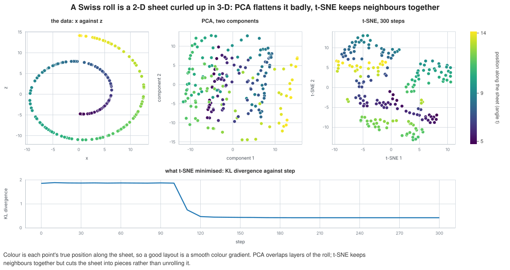

# A rolled-up sheet, flattened

A Swiss roll is a flat 2-D sheet curled up in 3-D. Two points far apart along the sheet can be close in space where the
layers touch. This example asks two methods to lay the points out in a plane again and measures how well each keeps
points that are neighbours on the sheet together.

## The data and the method

The data is 200 points from the Swiss roll generator, which keeps each point's true position along the sheet (the angle
t of the spiral, from 4.8 to 14.1). PCA is the linear projection onto the two directions of largest variance. t-SNE
(`tsne` in `mdml-engine/manifold`, perplexity 30, 300 steps) moves points in the plane by gradient descent so that
neighbour probabilities in the plane match those in 3-D.

## What the program does

1. Generate the roll, fit PCA with two components and transform the data.
2. Run t-SNE as a session with a checkpoint every 100 steps (the tape is 134 KB). Read its embedding at the last step,
   and its objective (the KL divergence) back at every tenth step.
3. Draw the three layouts side by side on one colour scale, the position along the sheet. The first panel is the data
   itself, x against z, where the roll shows as a spiral. The curve underneath is the t-SNE objective.

## What to look for

A good layout is a smooth gradient of colour. In the PCA panel the colours are mixed: the projection looks at the roll
from one side, so different layers land on top of each other. The t-SNE panel has patches of one colour, so neighbours
are kept together, but the sheet comes out in several pieces and is not unrolled into one strip. The KL divergence
stays near 1.85 for the first 100 steps (the early-exaggeration phase) and falls to 0.417 when it ends.

As numbers: the mean distance on the sheet (length along it and height across it, in the data's units) between a point
and its 5 nearest neighbours in the layout is 4.07 for the neighbours in the original 3-D space, 14.93 in the PCA plane
and 7.04 in the t-SNE plane. Two random points are 32.93 apart. t-SNE keeps the sheet's neighbours together much better
than PCA does, but not as well as the 3-D space; it does not recover the sheet's global shape.

## Run it

`make readme-examples ARGS="embedding"` rewrites `figure.svg` and `tape.json`. The program is [main.tsx](main.tsx).
