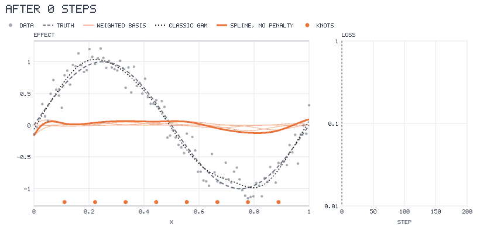

# A neural additive model, from its spline bases

This is the model of the proof of concept "Generalised additive model, neural" in `apps/pocs`, run without the page. A
generalised additive model writes `y` as a sum of smooth functions of the features. With one feature, that function is a
cubic B-spline: a sum of basis functions, each multiplied by a coefficient. The optimiser trains the coefficients, as it
would the weights of a network.

## What the program does

- It draws 100 noisy points from a sine curve on an even grid of x (`sineCurve`, noise 0.15) and keeps the true curve.
- It trains the spline for 200 steps with 8 interior knots and a smoothness penalty of zero, so nothing but the number of
  bases limits how closely the curve follows the points.
- At 17 chosen steps it asks the training session for the curve, the weighted basis functions (the pieces that add up to
  the curve) and the knots. They come from the tape of the run.
- For comparison it fits a classic GAM of the same data, where REML chooses the smoothing.

## What to look for

- In the animation the pale orange lines are the weighted bases and the thick orange line is their sum. At step 0 the sum
  is almost flat. As the bases grow, the sum is pulled up to the points. The loss on the right falls to about 0.02, close
  to the noise variance (0.15 squared is 0.0225).
- The thick orange curve and the dotted classic GAM end up almost on top of each other, and both sit close to the dashed
  true curve.

`figure.svg` is the last step as a still image. The tape is `tape.json`. To run it again:
`make readme-examples ARGS="gam-neural"`. Source: [main.tsx](main.tsx).
