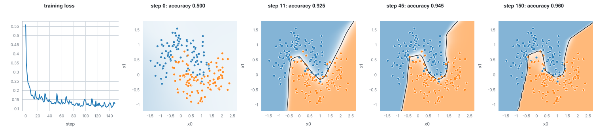

# A small neural network, trained and watched

A multilayer perceptron with two hidden layers of six units learns to separate the two moons, a dataset the library
generates together with its truth. The example trains it as a session, so the loss of every step is on the tape and the
network can be asked what it looked like at any earlier step.

## The program

`defineTrainer` turns a model (`mlp([2, 6, 6, 2])`), an objective (cross-entropy), an optimiser (Adam) and some settings
into an estimator. `network.session(data)` runs it; one session step is one epoch over 80 points in minibatches of 30.
After `advance()`, `probe(step, 'model/decision-surface')` returns the surface the network had at that step, and
`fittedAt(step).score(data)` its accuracy.

## What to look for

- Left: the training loss per step. It starts near 0.73, about what a network that always says "50 per cent" scores, and
  falls to 0.24.
- The other panels show the probability of the orange class as colour (blue for class 0, orange for class 1, white at
  0.5), over exactly the plotted range. The black line is the 0.5 contour of that same probability, so it is the
  boundary the network would use. The points are the training data.
- At step 0 the surface is almost flat. By step 8 it has found a bent boundary and by step 16 it follows the two moons.

## Printed values

Accuracy on the training data is 0.500, 0.875 and 0.887 at steps 0, 8 and 16. The generator knows the noise it added,
so the best possible accuracy is 0.939.

## Run it

`make readme-examples ARGS="neural-network"` writes `figure.svg` and `tape.json`. The program is [main.tsx](main.tsx).
