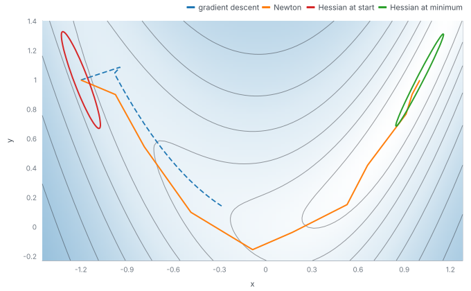

# Second derivatives

`grad` can be applied to its own result, and `hessian` and `hvp` are built from it. This example takes the second
derivative of a cubic, the Hessian of the Rosenbrock function, and a Hessian-vector product, then runs Newton's method,
which uses the Hessian to choose its steps. The comparison with other optimisers is in [../optimisers](../optimisers).

## The method

Rosenbrock's function is `f(x, y) = (1 - x)^2 + 10 (y - x^2)^2`, started at (-1.2, 1). Newton's method
(`newton` from `omai-engine/optim`) solves for the step with the Hessian, so it runs in 12 steps. Gradient descent with
learning rate 0.01 needs 2662 steps to get the gradient below 1e-5.

## What the program does

1. Print `grad(grad(cube))(2)` (12, since the cube's second derivative is 6x), `hessian(rosenbrock)` at (1, 1)
   (`[[82, -40], [-40, 20]]`) and `hvp(rosenbrock, (1, 1), (1, 0))` (`[82, -40]`, the first column of that Hessian,
   found without forming the matrix).
2. Run Newton and gradient descent with recorders attached, and read their paths from the tapes.
3. Take the Hessian at the start and at the minimum, and draw the level set of the local quadratic model around each
   point (`d' H d / 2` equal to a constant): an ellipse along the Hessian's axes.
4. Draw the paths and the ellipses over a heat map of log10(1 + f) that covers exactly the axes.

## What to look for

The ellipses are scaled for display: each has the same long axis, so that they fit in the plot; only the shape is the
Hessian's. At the start the curvature is about 152 across the valley and 2.6 along it, at the minimum about 102 and 0.4.
The thin ellipses say the same as the contours: the function is much steeper across the valley than along it. A gradient
step follows the steep direction and zigzags, which is why gradient descent (dashed, the first 60 steps) is only part of
the way down the valley. Newton divides by the curvature in each direction, so it goes along the valley and arrives in 12 steps.

## Run it

`make readme-examples ARGS="newton"` rewrites `figure.svg` and the two tapes (`tape-newton.json`,
`tape-gradient-descent.json`). The program is [main.tsx](main.tsx); the heat-map layers are in
[../_shared/maps.ts](../_shared/maps.ts).
