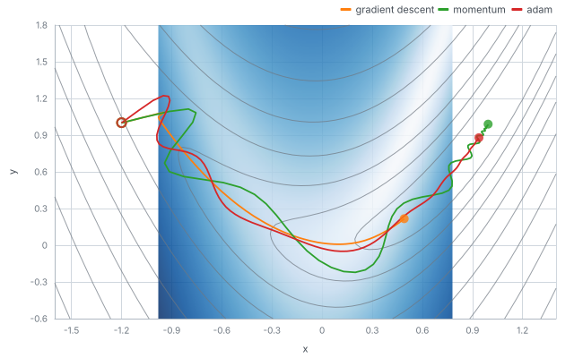

# Optimisers, first and second order

Six optimisers start from the same point on the Rosenbrock function, a curved valley with its minimum at (1, 1).
Gradient descent, momentum and Adam use only the gradient (first order). BFGS, L-BFGS and Newton also use curvature,
either as the Hessian itself (Newton) or as an estimate built from the last gradients (BFGS, L-BFGS).

## The method

The function is `f(x, y) = (1 - x)^2 + 10 (y - x^2)^2`, started at (-1.2, 1). The first-order methods are built with
`minimizer(f, start, optimiser)` from `omai-engine/optim` and run by `runAlgorithm` (gradient descent with learning rate
0.01, momentum with 0.005 and 0.9, Adam with 0.1). `bfgs`, `lbfgs` and `newton` are called with their default settings.
Every run is recorded with a policy that keeps the parameters and the loss at every step.

## What the program does

1. Run the six methods with a recorder attached: 250 steps for the first-order ones, until convergence for the others.
2. Read each run's parameters (`params.x` or `x`) and loss from its tape.
3. Draw the paths over a heat map of log10(1 + f) that covers exactly the axes, with contours of the same quantity.
   The window is the extent of all the paths and the minimum, with a small margin.
4. Draw the loss against the step on a log axis. Values below 1e-12 are drawn at 1e-12, because a log axis cannot show
   zero; the curvature methods end below that.
5. Run the first-order methods on, untraced, to count the steps until the loss is at most 1e-6.

## What to look for

Steps until the loss is at most 1e-6:

| method           | steps |
| ---------------- | ----: |
| gradient descent |  1525 |
| momentum         |   187 |
| Adam             |   239 |
| BFGS             |    17 |
| L-BFGS           |    20 |
| Newton           |    11 |

All of them find the valley quickly. The difference is what happens inside it. Gradient descent crawls along the floor
because the gradient points across the valley, not along it. Momentum overshoots and oscillates (the wiggles in the
purple line). BFGS, L-BFGS and Newton take steps that account for the valley's shape, and the loss falls by many orders
of magnitude in about twenty steps. A step is not the same cost for each: Newton forms the Hessian, L-BFGS keeps the last
ten pairs of gradient differences, and gradient descent only the gradient.

## Run it

`make readme-examples ARGS="optimisers"` rewrites `figure.svg` and the six tapes (`tape-gradient-descent.json`,
`tape-momentum.json`, `tape-adam.json`, `tape-bfgs.json`, `tape-lbfgs.json`, `tape-newton.json`).
The program is [main.tsx](main.tsx); the heat-map layers are in [../_shared/maps.ts](../_shared/maps.ts).
