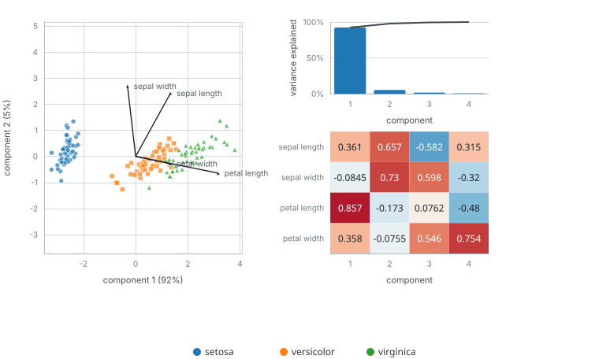

# Principal components of the iris data

Principal component analysis (PCA) finds the directions along which the data varies most. This example finds them one at
a time, so the tape shows the components appearing in order of variance.

## The data and the method

The data is the vendored iris data set: 150 flowers, four measurements each (sepal and petal length and width), three
species. The model is `pca` from `mdml-engine/decomposition` with the `power` solver, which finds one component per step
by power iteration, keeping each new one orthogonal to those already found.

## What the program does

1. Load the data and start a session with four components; one `advance()` runs the four steps.
2. Ask the session for its `model/params` (the components and the variance each explains) and `model/embedding` (every
   flower in component coordinates).
3. Put those into a `components` record, coloured by species, and draw it with the render package's components view.

## What to look for

Left, the flowers in the plane of the first two components, with each measurement's loading as an arrow: the species fall
into groups, setosa far from the other two. Top right, the share of the variance each component explains: 92.5%, 5.3%,
1.7% and 0.5%, so two components carry nearly all of it. Bottom right, the loadings as a matrix: the first component
weights petal length most (0.86) and the other three lightly; the second is mostly the two sepal measurements (0.66 and 0.73).

## Run it

`make readme-examples ARGS="pca"` rewrites `figure.svg` and `tape.json`.
The program is [main.tsx](main.tsx).
