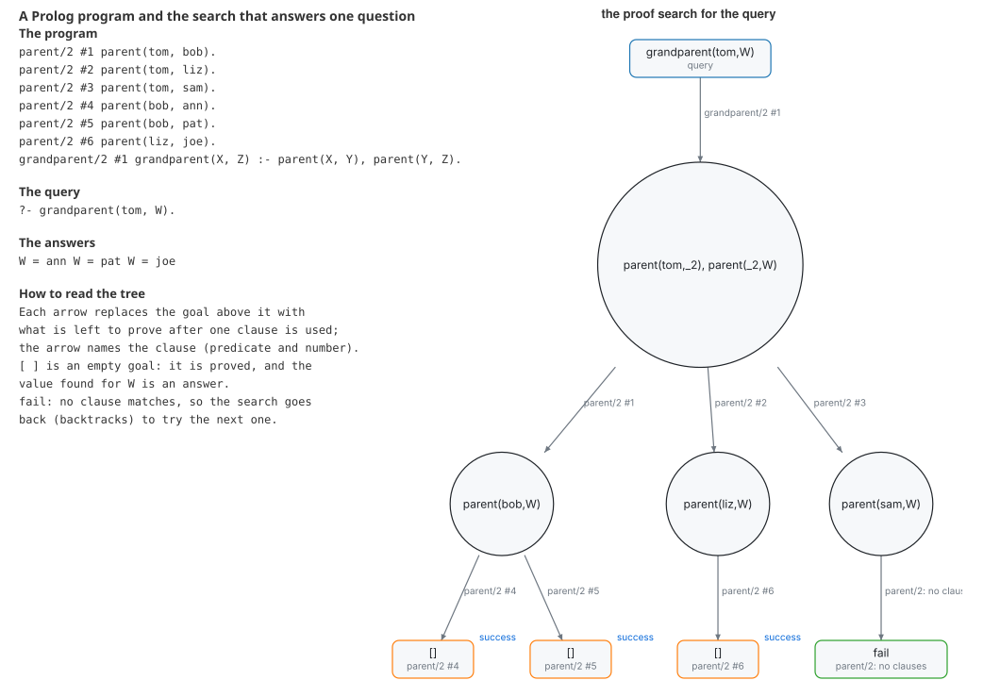

# A logic program and its proof search

Prolog answers a question by searching for a proof. This example loads a small family database, asks
`?- grandparent(tom, W).` and draws the search the engine made.

## The program

`parent/2` has six facts (Tom is the parent of Bob, Liz and Sam; Bob of Ann and Pat; Liz of Joe) and
`grandparent(X, Z) :- parent(X, Y), parent(Y, Z)` is the one rule. `consult` loads the text into a database and
`solve` answers the query by SLD resolution: depth first, left to right, with backtracking. With `recordTree: true` it
also keeps every resolvent it reached, and `sldTree` turns those into a structure that `diagram` draws.

## What to look for

- The root is the query. The rule rewrites it into two goals, `parent(tom, _), parent(_, W)`.
- The first goal has three matching facts, so the tree branches three ways: Bob, Liz and Sam.
- Under Bob there are two facts for the second goal, and under Liz one. The leaves marked `[]` have no goals left:
  each is an answer (`W = ann`, `W = pat`, `W = joe`).
- Sam has no children, so `parent(sam, W)` matches nothing. The branch ends in `fail` and the search backs up to try
  the next clause. That is a backtrack.

## The tape

The run is also recorded as a trace (`tape.json`): one event for each call, exit, redo and failure, in the order
the engine took them (Byrd's box model). It printed `20 steps, 7 inferences, 9 nodes in the tree, 1 failed branches`.

## Run it

`make readme-examples ARGS="prolog"` writes `figure.svg` and `tape.json`. The program is [main.tsx](main.tsx).
