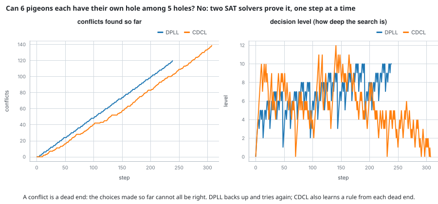

# Two SAT solvers on a hard puzzle

The pigeonhole puzzle: put six pigeons into five holes with at most one pigeon in each hole. It cannot be done, and a
SAT solver has to prove that. The puzzle is written as a Boolean formula in conjunctive normal form (30 variables,
81 clauses), and two solvers from `mdml-engine/logic` run on it.

## The program

Variable `(i, j)` means "pigeon i sits in hole j". Six clauses say each pigeon sits somewhere; 75 clauses say no hole
holds two pigeons. `dpll` searches by choosing a variable, propagating what follows, and backtracking when a clause is
falsified (a conflict). `cdcl` does the same but learns a new clause from every conflict and jumps back further than one
level. Both are run with a recorder, which keeps the number of conflicts and the current decision level at every step.

## What to look for

- Both report `unsat`, as they must. DPLL needed 119 decisions and 120 conflicts; CDCL needed 169 decisions and
  139 conflicts, and learned 138 clauses along the way.
- Left panel: conflicts so far. Both rise steadily. On this puzzle learning does not help, because pigeonhole formulas
  are hard for resolution-based solvers whatever they learn. Do not read the picture as "CDCL is slower".
- Right panel: the decision level is how deep the search is. DPLL moves up and down by one; CDCL sometimes drops
  several levels at once (a backjump) and ends by falling to level 0, where the formula is refuted.

## Run it

`make readme-examples ARGS="sat"` writes `figure.svg`, `tape-dpll.json` and `tape-cdcl.json`. The program is
[main.tsx](main.tsx).
