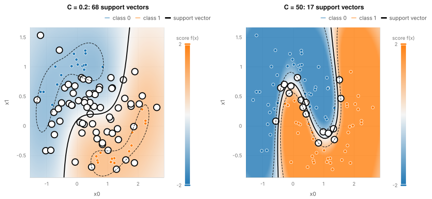

# Support vectors and the margin

A support vector classifier separates two classes with a boundary and keeps a margin on each side of it. This example
fits the same classifier twice to the same data, once with a small penalty `C` and once with a large one, to show what
`C` does to the margin and to which rows count as support vectors.

## The data and the method

The data is 100 points from the two-moons generator (noise 0.25). The generator carries its truth, so the best possible
accuracy is known: 0.940. The model is `svc` from `omai-engine/svm` with a Gaussian (rbf) kernel. It is fitted as a
session: the solver (SMO) updates the dual one pair of coefficients at a time, and the whole run is on the tape.

## What the program does

1. Generate the data with fixed keys, and a second set of 400 points that the model never sees.
2. For each `C` (0.2 and 50), start a session, run it to the end, and ask it for its `model/support-vectors` record
   (which rows are support vectors, and each row's functional margin).
3. Ask the fitted model for its score f(x) at every point of a grid that covers exactly the data's extent.
4. Draw the score as a heat map (orange where f is positive, class 1; blue where it is negative), the boundary f = 0 as
   a solid contour, the margins f = -1 and f = 1 as dashed contours, and ring the support vectors.

## What to look for

With `C = 0.2` the margin is wide and soft: 68 of the 100 rows are support vectors, 65 of them inside the margin, and the
boundary is smooth. With `C = 50` the margin is tight and follows the points: 17 support vectors, 13 inside the margin.
Accuracy on the training rows rises from 0.860 to 0.980; on the 400 new points it rises from 0.895 to 0.945, against the
best possible 0.940. Both panels show one quantity, the score, so the boundary and margins are contours of the colours.

## Run it

`make readme-examples ARGS="svm"` rewrites `figure.svg` and the two tapes (`tape-small-c.json`, `tape-large-c.json`).
The program is [main.tsx](main.tsx); the map helpers are in [../_shared/maps.ts](../_shared/maps.ts).
